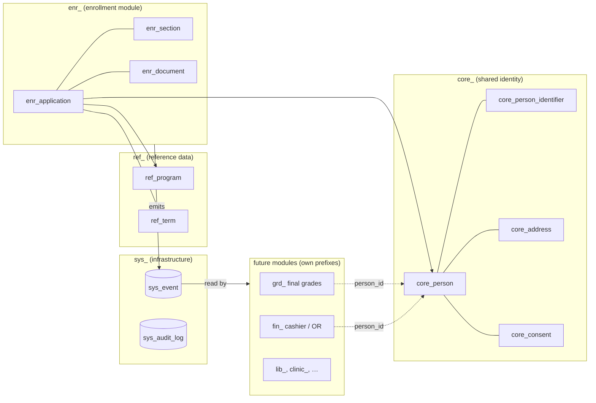

# Architecture: enrollment as the front door of a school-wide system

Enrollment is the **intake** of student identity. Grades, cashier, library, LMS rostering, clinic and
alumni systems will all need the same person, so the data is shaped now to let those systems join
later **without a rewrite and without copying student records around**.

The rule of thumb: **build only enrollment today, but never in a way that makes it the only system.**

## 1. One database, separate domains

SQLite has no schemas, so domains are table-name prefixes. Each prefix maps 1:1 to a PostgreSQL
schema if the college ever outgrows one SQLite file (`core_person` → `core.person`).



| Prefix  | Owner                    | Contains                                                                                                 |
| ------- | ------------------------ | -------------------------------------------------------------------------------------------------------- |
| `core_` | Registrar (data steward) | Who a person is (students, faculty, staff): PSA name, contacts, IDs, consent                             |
| `ref_`  | Registrar                | Programs, terms, subjects + prerequisites, curriculum versions                                           |
| `rec_`  | Registrar                | The student record: student number, program, curriculum, status                                          |
| `enr_`  | Enrollment module        | Applications, block sections, class offerings (schedule, room, professor, seats), class seats, documents |
| `sys_`  | Platform                 | Staff accounts + sessions, event log (outbox), append-only audit log                                     |
| `grd_`… | Future modules           | Their own facts, keyed by `core_person.id`                                                               |

**Ownership rule:** a module writes only its own prefix. It may read `core_`/`ref_`, but should
prefer reacting to events over querying another module's tables.

## 2. Identity: one person, many identifiers

- `core_person.id` is a **UUIDv7**. It is globally unique, so a future system (or a merged campus)
  can adopt it as-is, and it's time-ordered, so SQLite indexes stay compact.
- **The LRN is not the primary key.** Transferees, foreign students and data-entry mistakes make
  natural keys unsafe. Every external ID is a row in `core_person_identifier (scheme, value)`:
  `LRN` (DepEd) now; `STUDENT_NO`, `HEMIS` (CHED) and `SSO_SUBJECT` (school login) later. A new
  system gets a new _scheme_, not a new column.
- **PhilSys Card Number is never stored** (RA 11055); the QR only pre-fills the form.

## 3. Integration surfaces (how other systems join)

| Surface                       | Status   | Use it for                                                        |
| ----------------------------- | -------- | ----------------------------------------------------------------- |
| `GET /api/v1/events?after=N`  | ✅ built | Reacting to changes (new student, officially enrolled, …)         |
| `GET /api/v1/persons/:id`     | ✅ built | Fetching details for an ID received in an event (audit-logged)    |
| CHED EL / PR, UniFAST exports | planned  | Regulatory CSV/XLSX, generated server-side                        |
| OneRoster 1.2 CSV/REST        | planned  | Rostering Moodle / Google Classroom / Canvas without a custom LMS |
| OIDC single sign-on           | planned  | One school login; `SSO_SUBJECT` identifier links accounts         |

### The event log (transactional outbox)

Every change another system might care about writes a `sys_event` row **in the same SQLite
transaction** as the change itself (`emitEvent(tx, …)`), so events can't be lost or invented.
Consumers poll with a cursor; there's no broker to run:

```http
GET /api/v1/events?after=0&limit=100
Authorization: Bearer <INTEGRATION_TOKENS entry>
```

```json
{
	"events": [
		{
			"specversion": "1.0",
			"id": "01a181e3-10ea-7…",
			"source": "/enrollment",
			"type": "enrollment.application.submitted.v1",
			"subject": "01a181e3-10ea-71e5-…",
			"time": "2026-10-28T09:41:44.297Z",
			"data": {
				"applicationId": "…",
				"personId": "…",
				"termId": "2026-2",
				"programCode": "BSIT",
				"mode": "BLOCK",
				"sectionId": "…"
			},
			"seq": 2
		}
	],
	"next": 2
}
```

The envelope is [CloudEvents 1.0](https://cloudevents.io), a vendor-neutral standard, so later
consumers (an n8n workflow, a Go service, a data warehouse) can parse it without custom code.

**Event rules**

- Type naming: `<module>.<entity>.<past-tense-verb>.v<N>`. Published versions are frozen; changing
  a payload means publishing `.v2` alongside `.v1`.
- Payloads are **thin**: IDs and status only. Personal data is fetched through the authenticated,
  audit-logged person API. That keeps RA 10173 access control in one place.
- `sys_event` is append-only (SQLite triggers); `seq` is the consumer's cursor and is never reused.

### Current event catalog

| Type                                  | Emitted when                      | Data                                                            |
| ------------------------------------- | --------------------------------- | --------------------------------------------------------------- |
| `core.person.registered.v1`           | A new person record is created    | `personId`                                                      |
| `enrollment.application.submitted.v1` | A student submits the mobile form | `applicationId, personId, termId, programCode, mode, sectionId` |

Planned: `enrollment.application.assessed.v1`, `enrollment.application.officially_enrolled.v1`,
`enrollment.document.hardcopy_verified.v1`, `grades.final_grade.posted.v1`.

The source of truth for payload types is `EventCatalog` in `src/lib/server/events.ts`.

## 4. Growth path (only when a real limit is hit)

1. **Now:** one Node process, one SQLite file, Litestream/restic backups. Handles thousands of
   students on an N100 mini PC.
2. **A second module** (e.g. final grades): add a `grd_` prefix _in this same app and database_,
   subscribe to events internally. Still one deploy.
3. **A separate system** (vendor LMS, city ERP): it consumes `/api/v1` + events with its own token.
   Nothing in this codebase changes.
4. **If SQLite becomes the bottleneck** (unlikely below ~50k students): move to PostgreSQL, one
   schema per prefix. Drizzle supports both; the event and API contracts stay identical.

## 5. Things we deliberately don't do

- No microservices, message brokers, Redis or Kubernetes. The outbox + polling covers the need.
- No GraphQL. Plain, versioned JSON endpoints are easier for small IT teams and other vendors.
- No shared write access to `core_` from other systems. They request changes through the Registrar.
- No LMS, payroll, or accounting in this repo (see the research's scope matrix).
